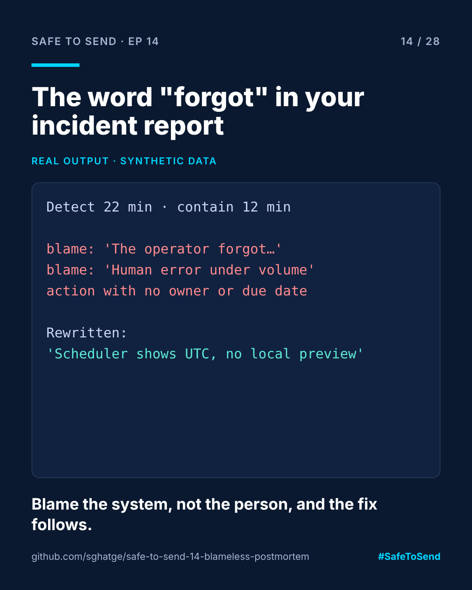

# safe-to-send-14 · Blameless Postmortem Kit



**Safe to Send · Episode 14** — Week 2 retrospective of a 28-day learn-in-public series on governing AI in CRM operations.

> Blame the person and the next mistake gets hidden. Blame the system and it gets fixed.

## The real-world scenario

A Greek Black Friday email goes out at 23:30 local time with English price formatting. The first draft of the incident report says "the operator forgot to check the send time" and lists "human error" as a cause. Everyone nods. Nothing about the scheduler changes, and next year it happens again in another market.

## The use case

Write the incident as a timeline. This tool turns it into a postmortem, calculates time to detect and time to contain, and lints it:

- **blame language** ("forgot", "careless", "should have", "human error") is flagged with the sentence it appears in
- **action items** without an owner and a due date are flagged

## Run it

```bash
python postmortem.py examples/gr_late_send.json
```

## Real example output (lint section)

```
## Lint
- blame language "forgot" in: ... The operator forgot to check the send time.
- blame language "Human error" in: Human error under Black Friday volume
- action without owner or due date: Review Black Friday staffing
```

The rendered postmortem also shows **time to detect: 22 min** and **time to contain: 12 min**: by the time anyone noticed, 38% of the audience had the email.

## Rewrite it blamelessly

"The operator forgot to check the send time" becomes "The scheduler showed UTC with no local-time preview". Same facts. One version produces a reprimand, the other produces a fix.

MIT · [Sangram Ghatge](https://www.linkedin.com/in/sangram-g-2369705b) · #SafeToSend
